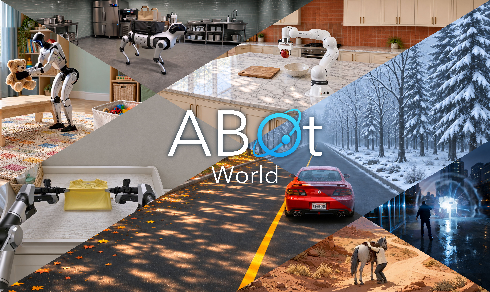

<div align="center">
  
  <h1>ABot-World-0.5: Reliable Physical Intelligence via Scaling</h1>
</div>

[![Studio](https://img.shields.io/badge/Studio-ABot_World_Iris-green?logo=)](https://abot-world.amap.com)
[![Reactor](https://img.shields.io/badge/Reactor-ABot_World_Halo-E9E4C2?logo=)](https://go.reactor.inc/abot-halo)
[](https://amap-cvlab.github.io/ABot-World/)

[](https://github.com/amap-cvlab/ABot-World)
[](LICENSE)

[](https://huggingface.co/acvlab/ABot-World-0-5-5B-Iris)
[](https://modelscope.cn/models/amap_cvlab/ABot-World-0-5-5B-Iris)
[](https://huggingface.co/acvlab/ABot-World-0-5-5B-Iris-BiT)
[](https://modelscope.cn/models/amap_cvlab/ABot-World-0-5-5B-Iris-BiT)

[](https://huggingface.co/datasets/acvlab/ABot-World-Explorer-500h)
[](https://modelscope.cn/datasets/amap_cvlab/ABot-World-Explorer-500h)
[](https://huggingface.co/datasets/acvlab/ABot-World-Explorer-4D)
[](https://modelscope.cn/datasets/amap_cvlab/ABot-World-Explorer-4D)

<div align="center">
  <h3>ABot-World Team</h3>
</div>

> **TL;DR:** ABot-World-0.5 carries each action's physical effects into the next. **Iris-5B** runs in real time on a single desktop GPU; **Halo-30B** streams video and audio in real time from the cloud.

## 📢 News

- **2026-11-25:** Meet ABot-World 0.5 Halo on , the most phsically real and most interactive world model we've ever build!
- **2026-11-24:** ABot-World 0.5 is here — Iris, Iris-BiT, and six interactive examples are now open. The v0.5 technical report is coming soon.

## 🚀 Highlights

- **Physical interaction** — In a *Chain of Causation* (CoC), the physical outcome of one action sets the initial conditions for the next. PhysTracer finds and annotates clips that preserve these links. Training on them makes collisions, falls, and surface contact more consistent and lets changes to the scene carry into later interactions. Scaling the training set from 150K to 1.2M examples raised the Physical Score from **32.43** to **68.07** for ABot-World 0.5 Iris and from **41.50** to **84.32** for ABot-World 0.5 Halo.
- **Action and prompt control** — Steer the character with the keyboard while Prompt Switch introduces new events through language, without stopping the rollout. During training, EventAlign ties each local prompt to its own interval in the video latents, so events take effect at the right moment.
- **Streaming video and audio** — Iris (5B) streams video at **21 FPS** on a single RTX 5090. Halo (30B) generates video and synchronized audio in one diffusion transformer and streams at **24 FPS**: **480p** on one NVIDIA B200 or **720p** on four.
- **Streaming decoding** — FantasyDecoder decodes each chunk as soon as it arrives, reusing features from the previous chunk. On 480p, 22-frame clips, it delivers **8.26×** the decoding throughput of the native Wan2.2 causal decoder, improves PSNR by **0.79 dB**, and reduces temporal flicker by **13.9%**.

<a name="models"></a>

## 📦 Models

| Model | Hugging Face | ModelScope |
| --- | --- | --- |
| Iris | [https://huggingface.co/acvlab/ABot-World-0-5-5B-Iris](https://huggingface.co/acvlab/ABot-World-0-5-5B-Iris) | [https://modelscope.cn/models/amap_cvlab/ABot-World-0-5-5B-Iris](https://modelscope.cn/models/amap_cvlab/ABot-World-0-5-5B-Iris) |
| Iris-BiT | [https://huggingface.co/acvlab/ABot-World-0-5-5B-Iris-BiT](https://huggingface.co/acvlab/ABot-World-0-5-5B-Iris-BiT) | [https://modelscope.cn/models/amap_cvlab/ABot-World-0-5-5B-Iris-BiT](https://modelscope.cn/models/amap_cvlab/ABot-World-0-5-5B-Iris-BiT) |

<a name="setup"></a>

## 🛠️ Setup

### 🐳 Option 1: Docker (Recommended)

Use the [Docker environment](docker/README.md). Download the checkpoints below before launching the container.

### 🔧 Option 2: Manual Installation

Follow the manual installation steps in the [V0 README](README-v0.md), then download the Iris checkpoints below instead of the V0 weights.

### 📥 Download Checkpoints

From the repository root, download Iris and optionally the bidirectional teacher:

```bash
hf download acvlab/ABot-World-0-5-5B-Iris --local-dir checkpoints/ABot-World-0-5-5B-Iris
hf download acvlab/ABot-World-0-5-5B-Iris-BiT --local-dir checkpoints/ABot-World-0-5-5B-Iris-BiT
```

Or use ModelScope:

```bash
modelscope download amap_cvlab/ABot-World-0-5-5B-Iris --local_dir checkpoints/ABot-World-0-5-5B-Iris
modelscope download amap_cvlab/ABot-World-0-5-5B-Iris-BiT --local_dir checkpoints/ABot-World-0-5-5B-Iris-BiT
```

**Custom resolution.** Iris defaults to 720p-class output (1280 × 704). For a custom `W × H` (both divisible by 32), set the last two values of `image_or_video_shape` in [`configs/iris/long_forcing_dmd.yaml`](configs/iris/long_forcing_dmd.yaml) to `[H // 16, W // 16]`; for Gradio, also update `STREAM_WIDTH` and `STREAM_HEIGHT` in [`abot_world/iris/config.py`](abot_world/iris/config.py). The [KV cache allocator](abot_world/iris/pipeline/causal_inference.py#L859) computes `local_attn_size * (H // 32) * (W // 32) + extra_tokens`, where `extra_tokens` is computed from the references. The default window holds `21 * 22 * 40 = 18,480` video tokens before reference tokens.

## 🤗 Gradio Demo

```bash
bash web_client/run.sh
```

Select one of the [six third-person scenes](examples/README.md), start the stream, then use `WASD` to move and `IJKL` to look.

- **Skill** — click either skill button to inject a local event prompt for four generation chunks via TAEC, triggering abilities like Shadow Gravity or Flame Jet at the right moment in the rollout.
- **Prompt Switch** — type a new scene description while streaming to redirect behaviors mid-rollout without restarting.
- **Prompt Cache** — pre-encode all example prompts once for instant startup: `python scripts/preencode_examples.py --device cpu`.

<a name="fantasydecoder"></a>

## ⚡ FantasyDecoder

Use `configs/iris/model_inference.yaml` and keep the decoder weights at
`checkpoints/ABot-World-0-5-5B-Iris/FantasyDecoder/model.pt`. Use
`FANTASYDECODER_CHECKPOINT` to override that path. For Gradio:
`ABOTWORLD_CONFIG=configs/iris/model_inference.yaml bash web_client/run.sh`.

```bash
python -m abot_world.iris.stream_cli --config configs/iris/model_inference.yaml \
  --first-frame examples/first_frames/9810c7b50f90eb92.png \
  --references examples/references/9810c7b50f90eb92 \
  --global-prompt "A hiker follows a trail through a redwood forest." \
  --keys W --blocks 20 --output outputs/iris-demo
```

FantasyDecoder refines frames on a compact spatial grid and streams with a
bounded cache. It replaces video decoding only; Wan2.2 VAE still encodes the
input image and references. Iris uses relative RoPE with either decoder.
Use `--config configs/iris/long_forcing_dmd.yaml` for TAEW2.2 instead.

In the report's **480p, 22-frame decoder benchmark** on RTX A6000,
FantasyDecoder ran at **68.63 vs. 8.31 FPS** for native Wan2.2 (**8.26×**),
with higher PSNR (**33.47 vs. 32.68 dB**), lower LPIPS (**0.0516 vs. 0.0582**),
and less flicker (**0.01939 vs. 0.02252**). These are decoder results, not
end-to-end FPS or a speed comparison against TAEW2.2.

## 👩🏻‍🏫 Bidirectional Teacher

```bash
python -m abot_world.bit.cli --example 1 --skill 1 \
  --output outputs/iris-bit-demo
```

BiT uses full-clip attention and absolute RoPE, with 48 denoising steps and CFG 3.0 by default.
See [custom inputs and weight checks](abot_world/bit/README.md).

## ❓ FAQ

See [FAQ.md](FAQ.md) for hardware, environment, and runtime questions.

## License

[Apache 2.0](LICENSE). See [NOTICE](NOTICE) and [third-party notices](THIRD_PARTY_NOTICES.md).

For commercial applications, or if you need production-quality reference images and prompts optimized for our model, feel free to reach out.

## 🤝 Acknowledgement

This project builds on and is inspired by the following open-source projects: [Causal Forcing](https://github.com/thu-ml/Causal-Forcing), [AngelSlim](https://github.com/tencent/AngelSlim), [LightX2V](https://github.com/ModelTC/LightX2V), [taehv](https://github.com/madebyollin/taehv), [Wan2.2](https://github.com/Wan-Video/Wan2.2), [Helios](https://github.com/PKU-YuanGroup/Helios), from which the optimized Triton RoPE and normalization kernels in `wan/modules/helios_kernels` are derived.

## 🗓️ Roadmap

- [x] Iris, bidirectional teacher, and interactive examples
- [ ] v0.5 technical report (arXiv)

## 🛰 Contact Us via WeChat Group

Feel free to contact us!
<div align="center">
  
</div>

[Read the original ABot-World v0 README](README-v0.md)
